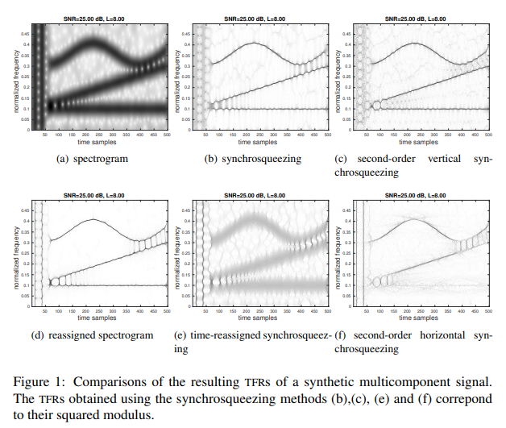
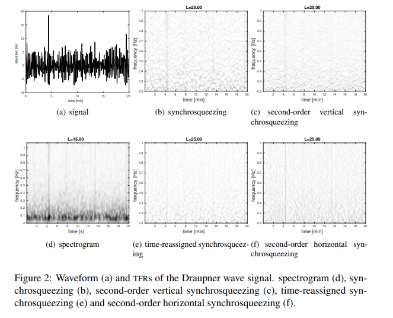
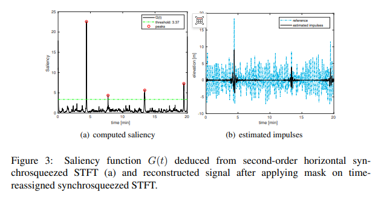

# Time-Frequency Analysis: Second-Order Time Redistribution Synchronous Squeezing Transformation: Application of Zhuopu Na Wave Analysis with MATLAB Code

Second-Order Time Redistribution Synchronous Squeezing Transform: Analysis and Application of Zhuopuna Wavelets
Abstract: This paper addresses the issue of efficient time-frequency joint characterization for non-stationary multicomponent signals, proposing a novel improved algorithm for time redistribution synchronous squeezing methods. It enables clearer and reversible time-frequency representations for pulsed or emphasized signals. After establishing a theoretical link between this new method and the author's previous research achievements, numerical experiments validate its performance enhancement in synthetic signal and real signal analysis. The method is applied to Zhuopuna wavelet record analysis, yielding groundbreaking results in time-frequency analysis.
Introduction: The core goal of time-frequency and time-scale analysis is to develop efficient innovative methods for processing non-stationary multicomponent signals. Classical linear transformations such as Short-Time Fourier Transform (STFT) and Continuous Wavelet Transform (CWT) are widely used in audio, biomedical, earthquake, radar, and other fields. However, they are limited by the Heisenberg-Gabor uncertainty principle, resulting in ambiguous time-frequency representations, poor energy concentration, and a trade-off between temporal and frequency localization accuracy.
Redistribution methods can enhance the readability of time-frequency representations but are irreversible, only applicable for analysis or modeling scenarios; Synchronous squeezing, as a variant of redistribution techniques, combines sharpening representation with reversibility, deriving applications such as denoising, component extraction, and separation through signal reconstruction capabilities.
Current research focuses on the calculation of synchronous squeezing for various linear transformations, as well as improving instantaneous frequency estimators to enhance the localization effect of emphasized signals, among which the second-order horizontal synchronous squeezing method can handle both pulsed and emphasized signals but performs poorly on mixed signals that contain both pulsed and periodic components.
To address this, this paper introduces a new transformation, second-order horizontal synchronous squeezing, which improves the energy localization precision and readability of time-redistribution synchronous squeezing by enhancing the group delay estimator. A mathematical link has been established between this estimator and the author's previous research achievements.
Method Introduction The core method of this paper is the second-order time redistribution synchronization extrusion transformation, which is based on short-time Fourier transform. It revolves around three core processes: redistribution, base time redistribution synchronization extrusion, and second-order horizontal synchronization extrusion. The core lies in the optimization of time-frequency representation through improved group delay estimation while maintaining signal reconstruction capability. The specific key steps and definitions are as follows:
1  
Basic Short-Time Fourier Transform (STFT): It defines the STFT expression based on a differentiable analysis window, derives its Fourier transform correlation formula and signal reconstruction formula, laying the foundation for subsequent transformations.
2  
Redistribution method: By using a group delay estimator and an instantaneous frequency estimator, the signal energy is mapped from the original time-frequency points to new estimated points, achieving sharper time-frequency representation. However, this method loses phase information, making the representation irreversible.
3  
Time-reshuffled Synchronous Squeezing STFT: By abandoning the mapping of reshuffled to "signal energy," and instead mapping it to "signal transformation," retaining the original phase information, this achieves the invertibility of time-frequency representation. The precise signal reconstruction formula is derived.
4  
Second-order horizontal synchronous extrusion (core improvement)
★  
A model of linear chirp signal is used to analyze the bias problem of traditional group delay estimator, and an enhanced second order group delay estimator is proposed to compensate for the bias defect of traditional second order estimator when the logarithmic amplitude second derivative is non-zero.
★  
An unbiased local modulation estimator is introduced (experimentally verified to have higher accuracy than other types of estimators), and integrated into group delay estimation, resulting in a new expression for the second-order group delay estimate.
★  
Replace the traditional group delay estimator in time redistribution synchronization squeezing with a second-order time redistribution synchronization squeezing transformation. This method has equivalent computational complexity to that of second-order vertical synchronization squeezing and is suitable for any differentiable analysis window (in this experiment, a Gaussian window, i.e., Gabor transform).
5  
Numerical Implementation: Discreteize the above theoretical expressions, and calculate using the rectangular approximation method. Choose even number of frequency bins to ensure the engineering feasibility of the method.
At the same time, in the experiment, the reconstructed quality factor (RQF) is used to quantify the signal reconstruction ability of each method. The detection and extraction of pulse components in signals are realized by combining the significance function with a threshold mask.
Conclusion This paper proposes a new extension method for time redistribution synchronization squeezing based on short-time Fourier transform - the second order horizontal synchronization squeeze transformation. Experimental results show that this method achieves significant improvements in constructing the reversible and high-definition time-frequency representation of pulse signals, filling the gap in pulse signal processing with vertical synchronization squeezing, and shows good effectiveness in both synthetic signal analysis and actual signal analysis.
When applied to the analysis of Zhuopu Nabo signals, this method successfully identified previously unrecognized components in the signals, providing an important basis for understanding the phenomenon of ghost waves.
Subsequent research will focus on refining the theoretical framework of this method and develop more practical application scenarios based on it.

## Images

<!-- PAYMENT_BLOCK -->

## Get this dataset

- Payment link (Stripe): [Buy now](https://buy.stripe.com/3cs8yP7sY87d0vu9AB)
- Payment QR code: 

<!-- /PAYMENT_BLOCK -->
